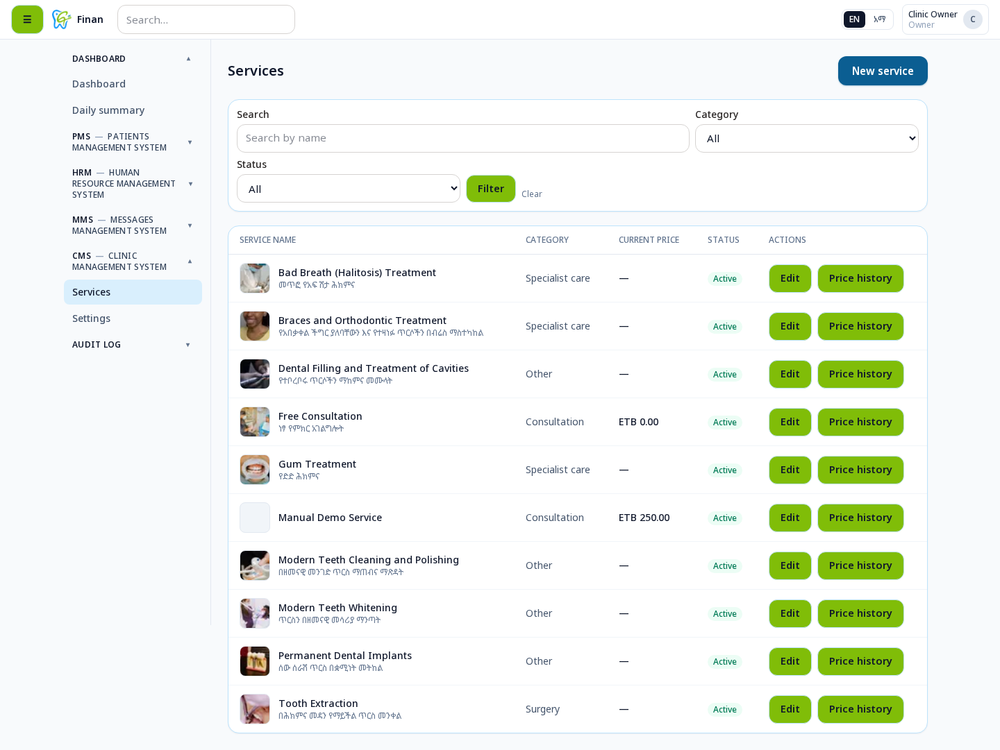
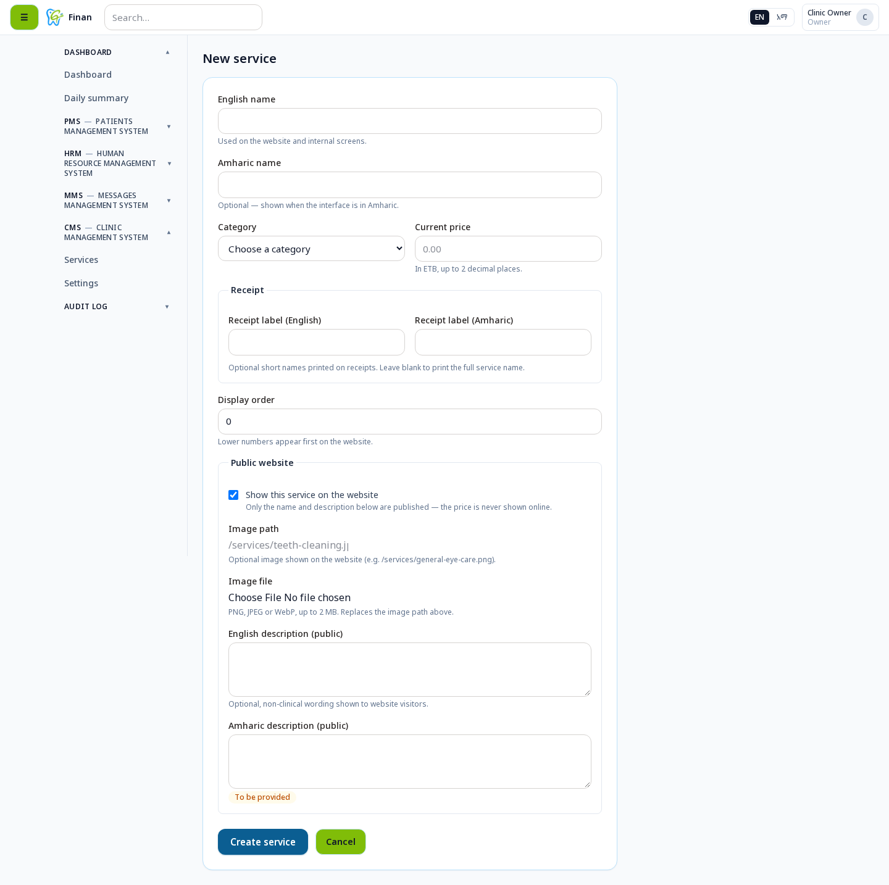
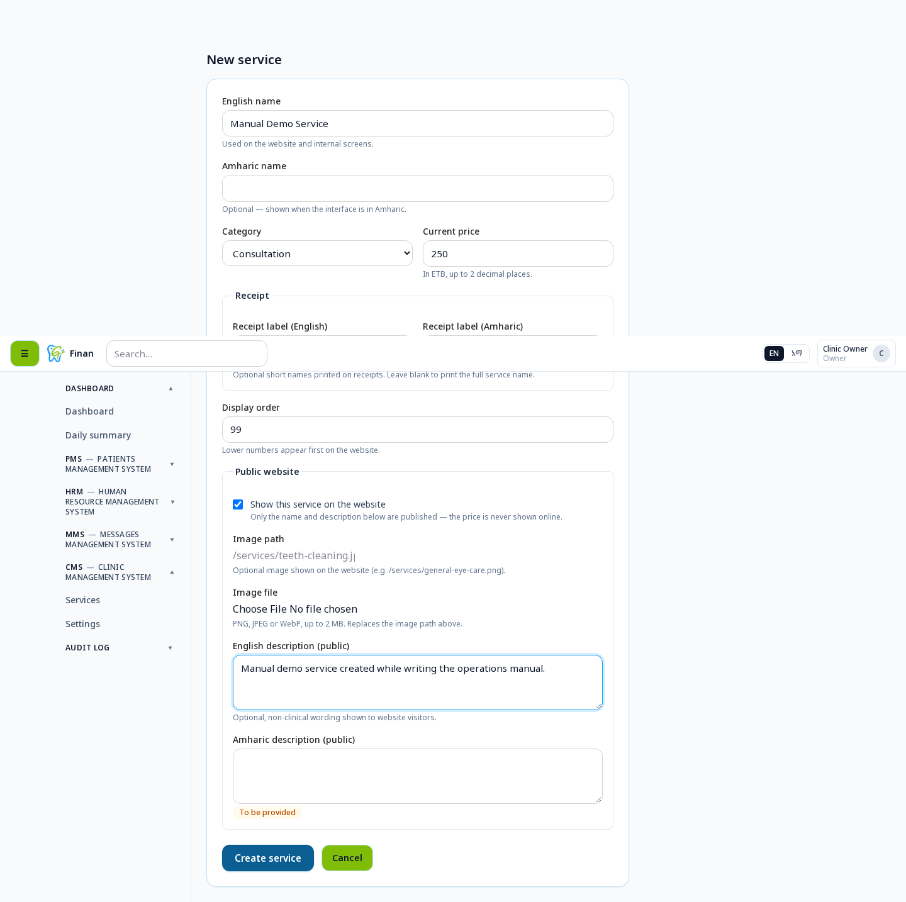
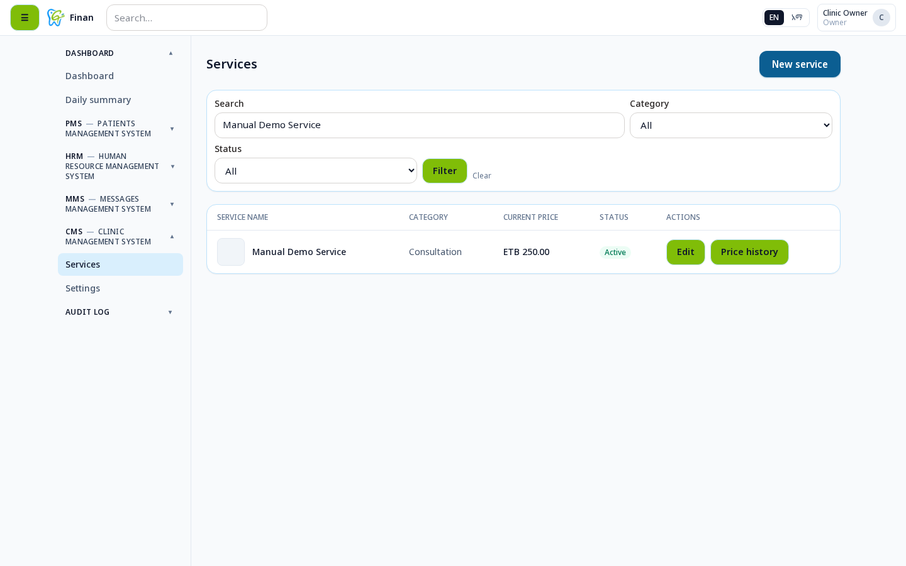
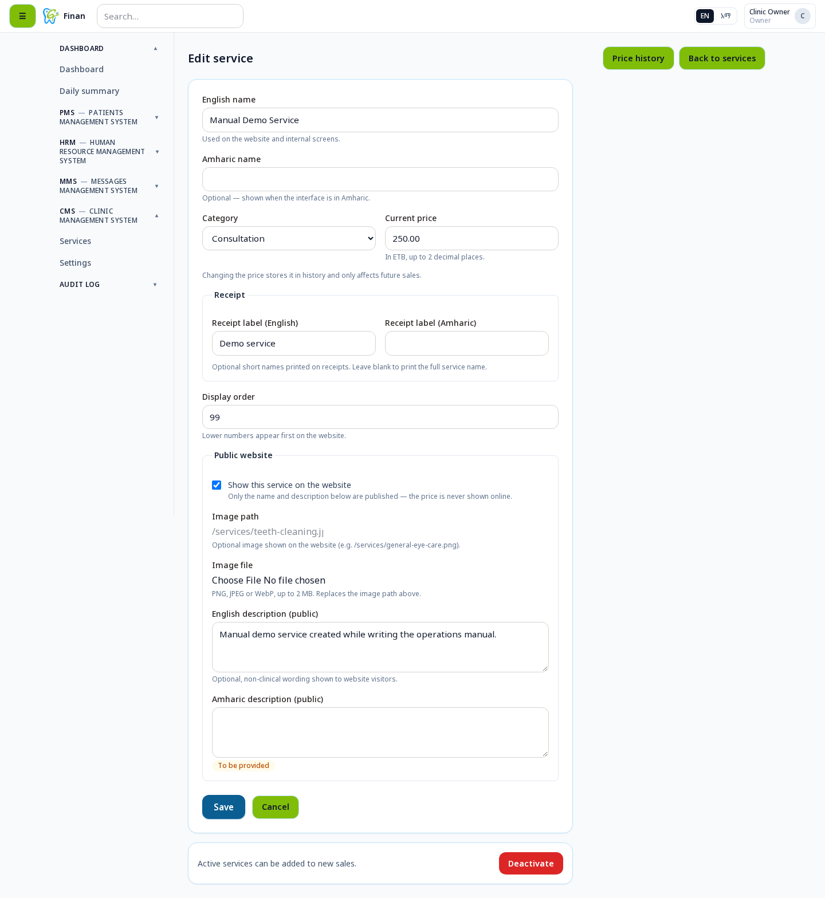
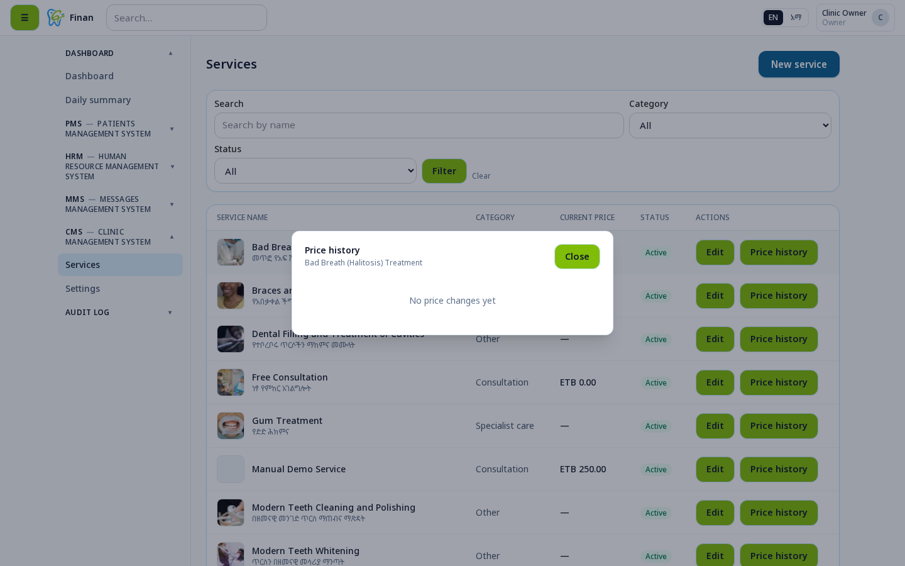
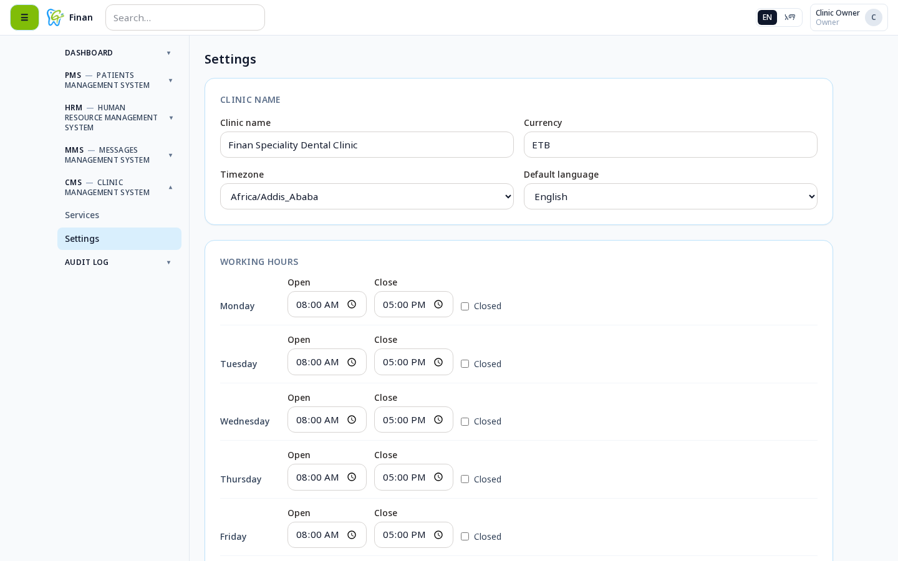
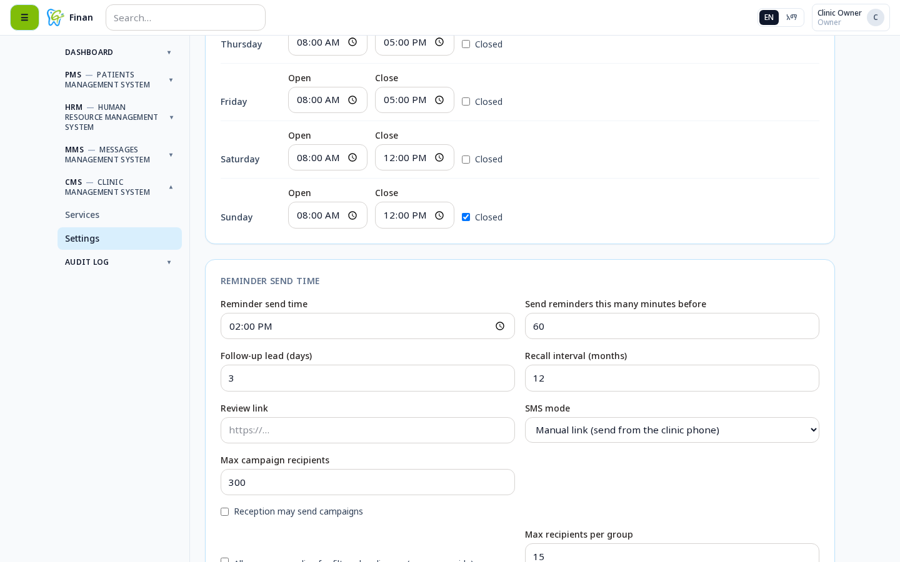
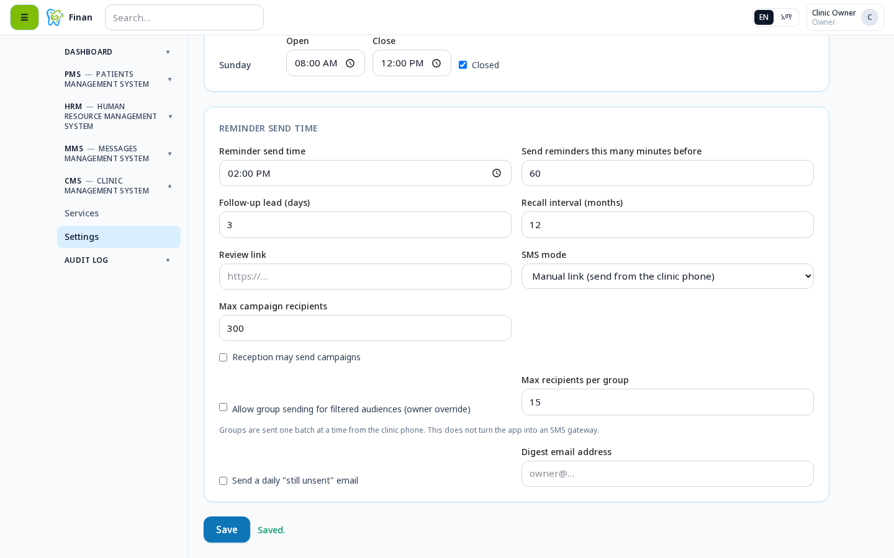

# Clinic Management System (CMS) Manual
**Finan Speciality Dental Clinic - ERP**

Version 1.0 | November 2026

---

## Table of Contents

1. [Introduction](#1-introduction)
2. [Service Management](#2-service-management)
3. [Price History](#3-price-history)
4. [Clinic Settings](#4-clinic-settings)
5. [Working Hours](#5-working-hours)
6. [Messaging Settings](#6-messaging-settings)

---

## 1. Introduction

The Clinic Management System (CMS) handles service catalog management, pricing, and clinic configuration settings for Finan Speciality Dental Clinic.

---

## 2. Service Management

### 2.1 Services List

The Services List displays all dental services offered by the clinic, including:
- Service name
- Category
- Price (ETB)
- Duration
- Status (Active/Inactive)

### 2.2 Adding a New Service

#### Empty Service Form

To add a new service:
1. Navigate to Services → Add New Service
2. Fill in the service details

#### Filled Service Form

**Required Fields:**
- **Service Name** - Name of the dental service
- **Category** - Service category (General, Specialist, Preventive, etc.)
- **Price** - Service price in Ethiopian Birr (ETB)
- **Duration** - Service duration in minutes
- **Description** - Service description (English/Amharic)
- **Active** - Toggle to make service available

### 2.3 Service Created

Confirmation message after successfully creating a new service.

### 2.4 Editing a Service

To edit an existing service:
1. Click "Edit" on the service from the services list
2. Update the required fields
3. Click "Save" to apply changes

---

## 3. Price History

The Price History feature tracks all price changes for services over time, providing an audit trail of pricing modifications.

---

## 4. Clinic Settings

Configure basic clinic information:
- Clinic name
- Contact details
- Address
- Logo
- Other general settings

---

## 5. Working Hours

Set the clinic's operating hours:
- Configure working days
- Set opening and closing times for each day
- Mark holidays/non-working days
- Define appointment availability

---

## 6. Messaging Settings

Configure SMS/messaging settings:
- SMS provider configuration
- Message templates settings
- Notification preferences
- Campaign settings

### 6.1 Settings Saved

Confirmation message after successfully saving clinic settings.

---

**For Support:** Contact the system administrator for assistance with the CMS module.
