# Message Management System (MMS) Manual
**Finan Speciality Dental Clinic - ERP**

Version 1.0 | November 2026

---

## Table of Contents

1. [Introduction](#1-introduction)
2. [Outbox](#2-outbox)
3. [Templates](#3-templates)
4. [Message Library](#4-message-library)
5. [Composing Messages](#5-composing-messages)
6. [Campaigns](#6-campaigns)
7. [Drafts](#7-drafts)
8. [Reports](#8-reports)

---

## 1. Introduction

The Message Management System (MMS) handles all SMS and messaging communications at Finan Speciality Dental Clinic, including appointment reminders, campaigns, and patient notifications.

---

## 2. Outbox

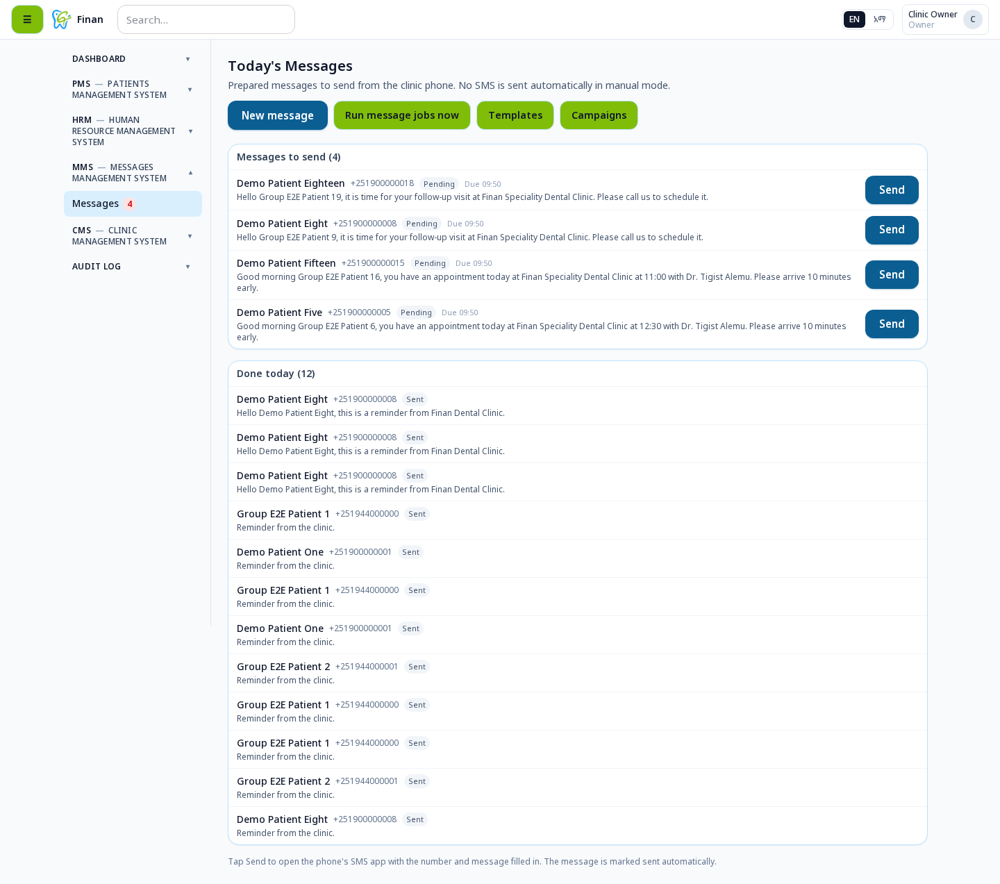

The Outbox displays all sent and pending messages:
- Message status (Sent, Pending, Failed)
- Recipient information
- Message content
- Date and time sent
- Delivery status

### 2.1 Outbox After Sending

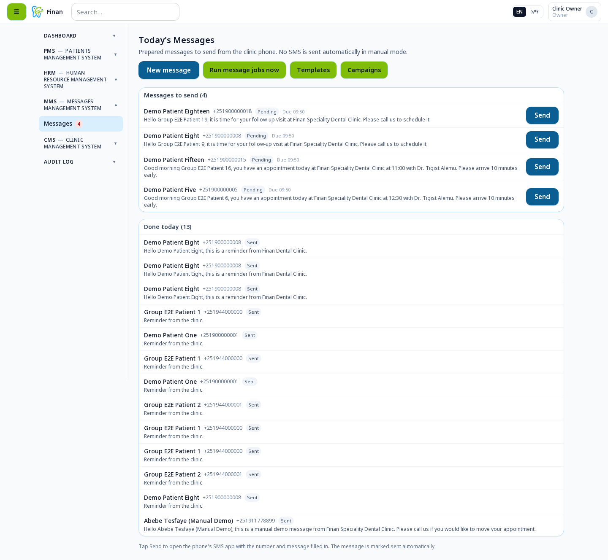

After sending messages, they appear in the outbox with updated status.

---

## 3. Templates

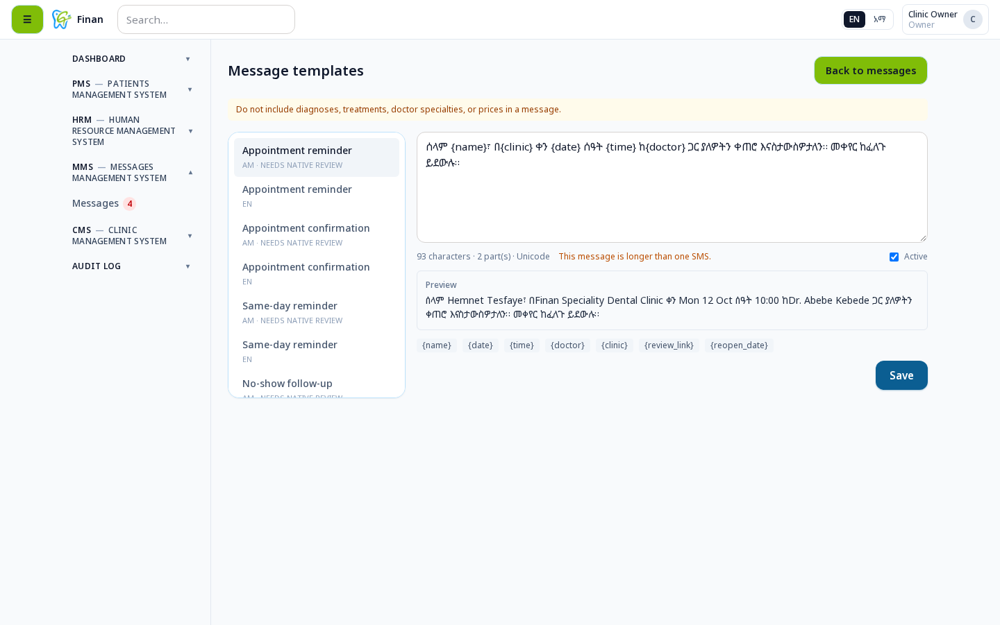

Manage reusable message templates for common communications like appointment reminders, follow-ups, and greetings.

---

## 4. Message Library

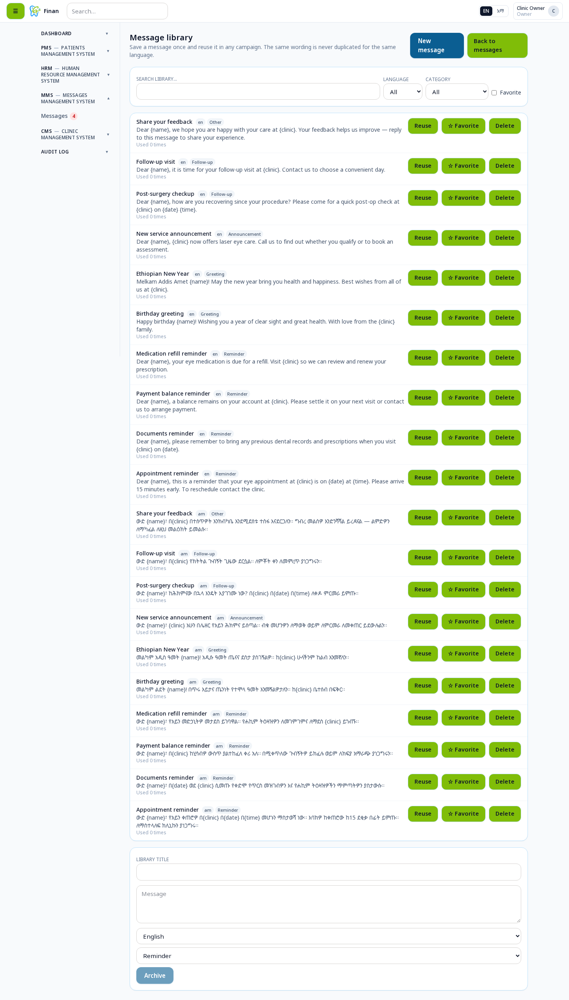

The Message Library contains pre-defined message templates categorized by type:
- **REMINDER** - Appointment reminders
- **GREETING** - Birthday and holiday greetings
- **ANNOUNCEMENT** - New services and announcements
- **FOLLOWUP** - Post-visit follow-ups
- **OTHER** - Miscellaneous messages

---

## 5. Composing Messages

### 5.1 Empty Compose Form

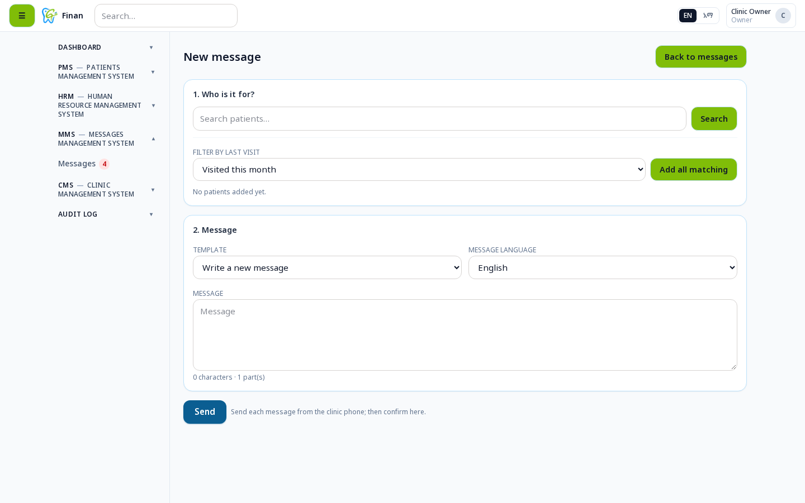

To compose a new message:
1. Navigate to Messages → Compose
2. Select recipients
3. Choose a template or write custom message
4. Send or schedule

### 5.2 Search Recipients

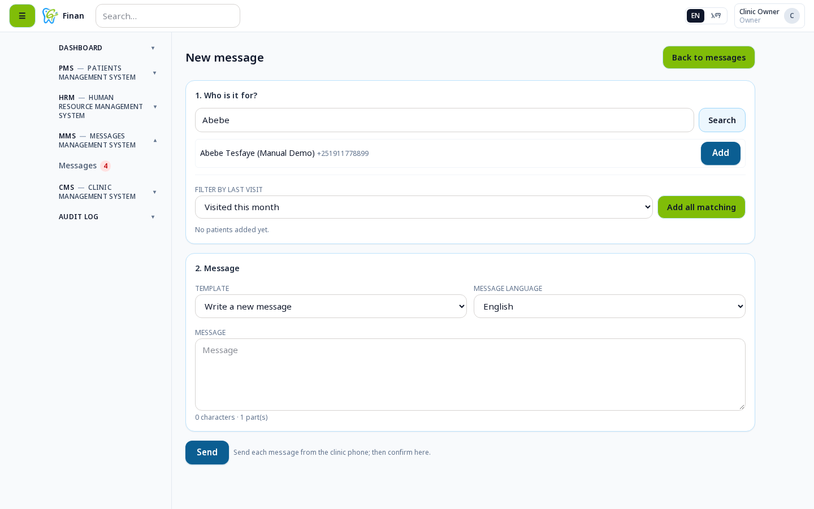

Search for specific patients to send messages to.

### 5.3 Select Recipients

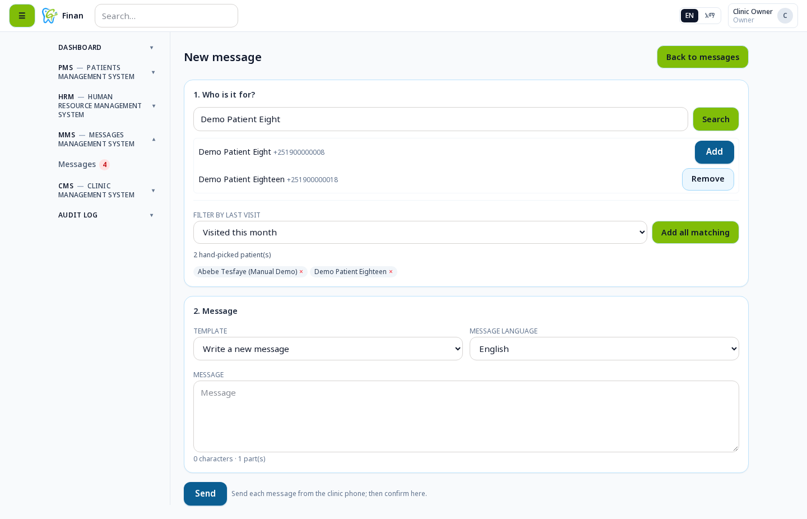

Select one or multiple recipients from the patient list.

### 5.4 Choose Template

Select a message template from the library or templates section.

### 5.5 Filled Compose Form

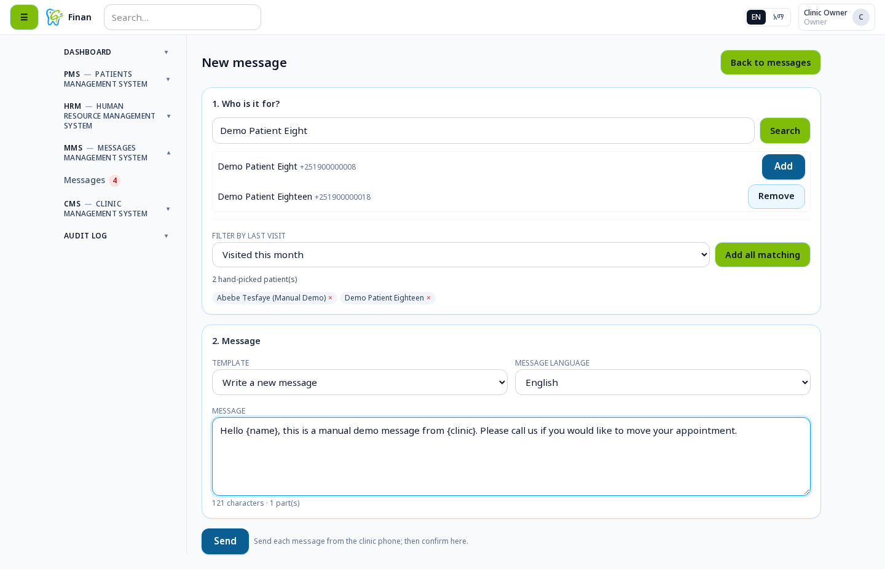

Review your message with selected recipients and template applied.

### 5.6 Confirm Message

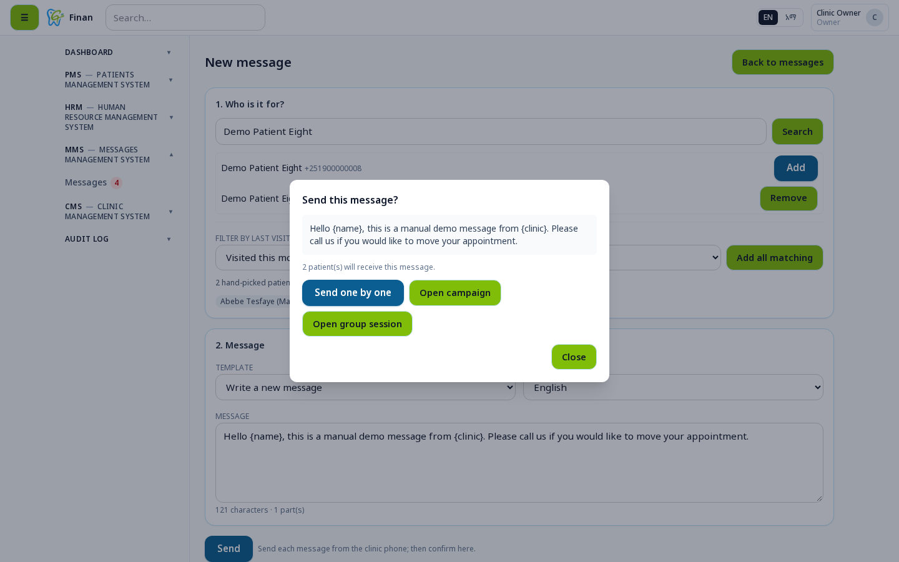

Confirm the message details before sending.

### 5.7 Send List

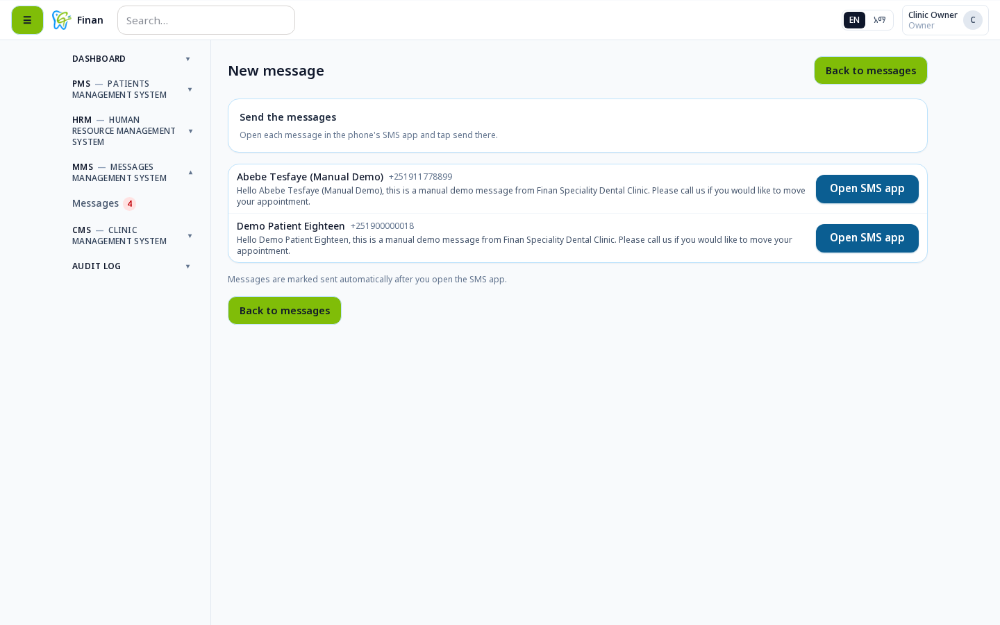

Review the final list of recipients before sending.

### 5.8 Message Sent

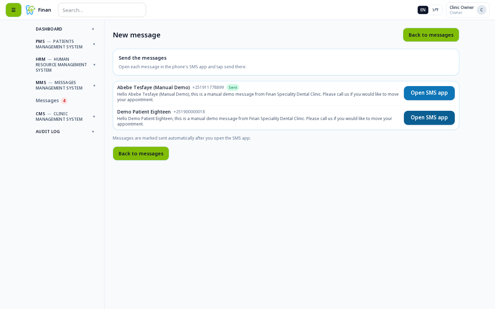

Confirmation message after successfully sending messages.

---

## 6. Campaigns

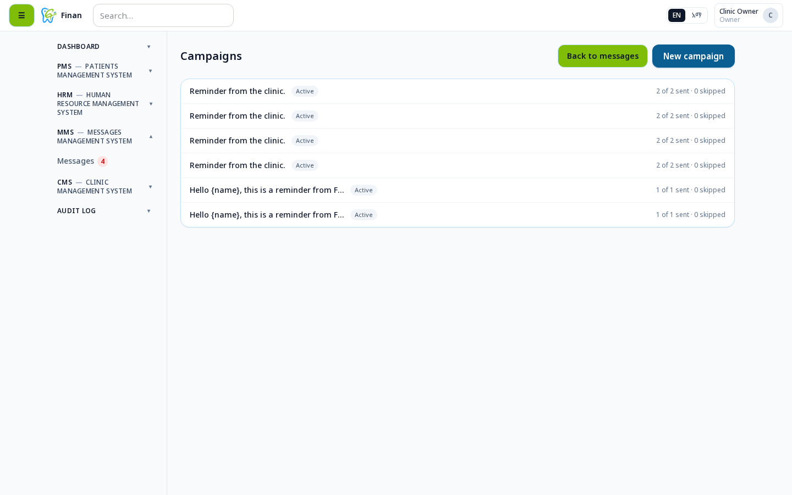

Create and manage bulk messaging campaigns:
- **Create Campaign** - Set up targeted campaigns
- **Audience Filtering** - Filter by language, visit history, SMS consent
- **Scheduling** - Send immediately or schedule for later
- **Tracking** - Monitor campaign performance (Sent, Opened, Skipped)

---

## 7. Drafts

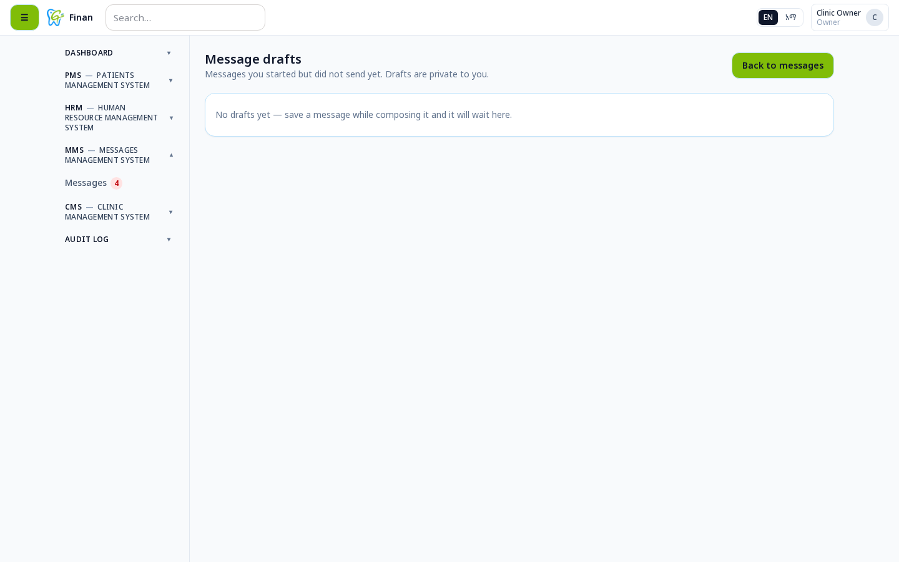

Save unfinished messages as drafts and return to them later for editing and sending.

---

## 8. Reports

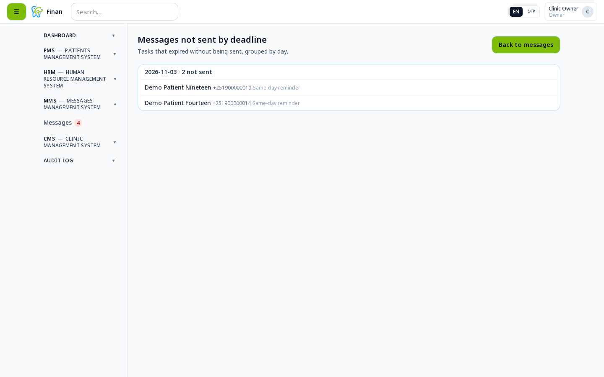

View messaging analytics and reports:
- Message delivery statistics
- Campaign performance metrics
- SMS credit usage
- Success/failure rates

---

**For Support:** Contact the system administrator for assistance with the MMS module.
